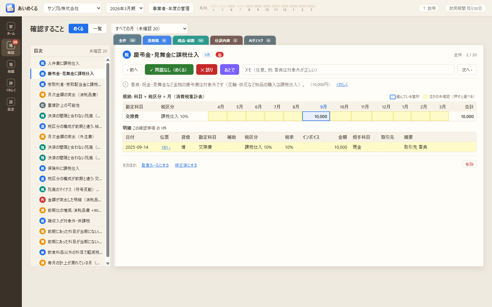
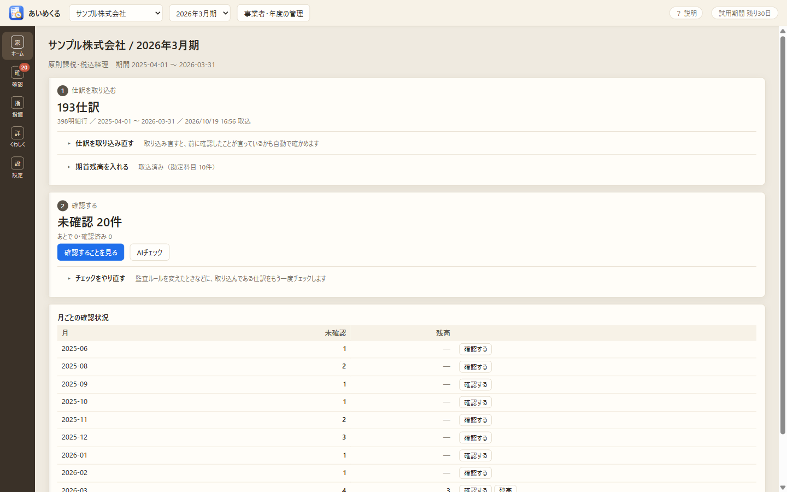

# あいめくる（aimekuru）試用版

**あいめくる**は、仕訳と消費税区分を確認するための Windows アプリです。
会計ソフトから出力した仕訳日記帳のCSVを読み込み、監査ルールと統計で気になるところを拾い、帳簿をめくるように1件ずつ人が確かめます。「誤り」としたものは、指摘事項一覧にまとめて CSV 出力・印刷できます。

このリポジトリは、試用版の配布用です（ソースコードは置いていません）。



## ダウンロード

[Releases](../../releases/latest) から、どちらか一方をダウンロードしてください。

| ファイル | 内容 |
|---|---|
| `aimekuru-0.1.0-setup.exe` | インストーラー。スタートメニューに登録されます（迷ったらこちら） |
| `aimekuru-0.1.0-portable.exe` | インストール不要。このファイルだけで起動できます |
| `aimekuru-user-guide.html` | 使い方ガイド（アプリの「設定」からも開けます） |
| `SHA256SUMS.txt` | exe の SHA-256 |

## できること

- **取り込む**: 弥生会計の仕訳日記帳（インポート形式）のCSV、期首残高（残高試算表・補助残高一覧表のCSVをそのまま）。列を自分で対応付ける自由形式もあります
- **自動でチェックする（AIは使いません）**: 消費税区分の監査ルール（約60件）、月次・明細金額の外れ値、補助科目ごとの決済の間隔と合わない残高、新しい補助科目、前期との比較など
- **1件ずつめくって確かめる**: 理由・根拠の表・明細を1ページで見せ、「問題なし」「誤り」「あとで」を記録します
- **指摘事項一覧**: 「誤り」としたものをまとめ、CSV出力・印刷
- **取り込み直し後の確認**: 修正後に取り込み直すと、指摘が直ったかを自動で確かめます
- **AIチェック（任意）**: このPCの中で動く小さなAI（ローカルLLM）が、損益科目の月ごとの動きから気になるところを挙げ、明細から確かめることを書きます



画面の写真は、すべてアプリに付けている架空のサンプルデータです。

## 動作環境

- Windows 10 / 11（64bit）
- AIチェック・ルール作りの支援を使う場合: 初回に設定画面からモデル（Gemma 4 E2B、約3.2GB）をダウンロードします。モデルはCPUで動かすので、メモリに余裕のあるPCをおすすめします

仕訳などのデータは、このPCの中だけで扱い、外部へは送りません。インターネットを使うのは、AIのモデルをダウンロードするときと、新しい版があるかを確かめるとき（版の番号を問い合わせるだけ）だけです。データは `%APPDATA%\shohizei-check` に保存されます（暗号化はしていないので、PCのアカウントやディスクの暗号化で守ってください）。

## インストールのときの注意

- コード署名をしていないため、初回の起動で Windows の「PC が保護されました」（SmartScreen）の画面が出ることがあります。「詳細情報」から「実行」を選ぶと起動できます
- ダウンロードしたファイルは、SHA-256 の値で確かめられます（PowerShell）

```powershell
Get-FileHash .\aimekuru-0.1.0-setup.exe -Algorithm SHA256
```

| ファイル | SHA-256 |
|---|---|
| aimekuru-0.1.0-setup.exe | `43c628db65d1b3b6d27dedbf524c912a34f6e5dd2f77e9e63701dbc5c1bf714c` |
| aimekuru-0.1.0-portable.exe | `ad7a2e07fa10d977a04779c0885ab33e8edc71b8d19c236a4a78794a605fc8b3` |

## 新しい版

アプリの「設定」→「アプリの更新」の「更新を確かめる」で、このリポジトリに新しい版があるかを確かめられます（「起動したときに確かめる」は、はじめはオフ）。新しい版は、インストーラーを上書きで実行する（ポータブル版はファイルを差し替える）だけで入れ替えられ、取り込んだデータはそのまま使えます。

## 試用期間

初回起動から30日間、すべての機能を使えます。30日を過ぎると、ライセンストークンを登録するまで使えなくなります（取り込んだデータは消えません）。

試用期間のあとも続けて使うためのライセンストークンは、noteメンバーシップ「[【AI×プログラミング】業務アップデート実践Lab](https://note.com/note_tds/n/n505ae4dd9ff5)」の掲示板でお知らせします。

トークンは、アプリの右上の「試用期間 残り○日」の表示（期限が切れたあとは、起動したときの画面）から登録できます。登録しても、それまでに取り込んだデータはそのまま使えます。

## ご利用にあたって

- あいめくるは、確認作業を補助するためのツールです。税務上の取扱いを判定・保証するものではありません。見つかったことは、必ず元の証憑や会計データと照らし合わせ、最終的な判断はご自身で行ってください
- 試用版のため、不具合が残っている可能性があります。大切なデータは、会計ソフト側で保管したうえでお試しください
- アプリに含まれるオープンソースソフトウェア（Electron、llama.cpp など）のライセンス表示は、インストール先の `resources\THIRD-PARTY-NOTICES.txt` にあります

Copyright © 2026 ただし
